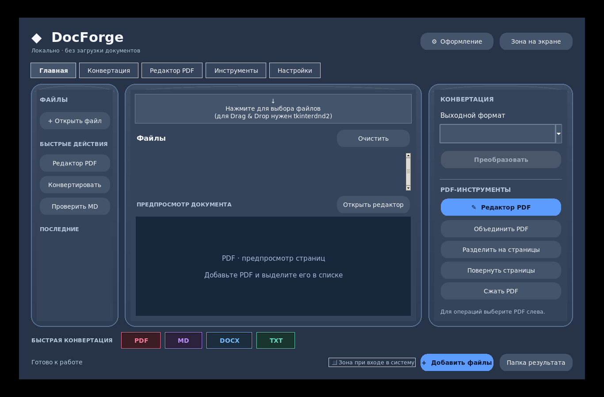

# DocForge

**Локальный конвертер документов и редактор PDF для Windows 10/11 и Linux.** PDF, Markdown, DOCX, изображения, таблицы и презентации; редактирование содержания PDF через независимую DOCX-копию; плавающая зона Drag & Drop; контекстное меню файлового менеджера.



> **Текущий пакет: приложение 1.11.0, исправленный Windows-установщик 1.11.4.** Исходный код и сетевые установщики. Это не подписанный, автономный Windows EXE. При первой установке потребуется интернет. Работа графического установщика и Drag & Drop на каждой конфигурации Windows/GNOME требует отдельной проверки. Сложная вёрстка DOCX/XLSX/PPTX может отличаться от оригинала.

## Установка Windows 10/11 (x64)

1. Откройте вкладку **[Releases](../../releases)** и скачайте `DocForge-Windows-1.11.4.zip` (либо в GitHub выберите **Code → Download ZIP**).
2. Распакуйте **весь архив**, а не один CMD-файл. При предупреждении SmartScreen изучите происхождение файлов и контрольную сумму; не отключайте защиту системы глобально.
3. Дважды щёлкните **`INSTALL-WINDOWS.cmd` в корне папки**. Откроется графический установщик.
4. При первой установке DocForge автоматически скачает собственный Python 3.13, библиотеки и Pandoc. LibreOffice / Microsoft Office не нужны; права администратора обычно не требуются.
5. После проверки конвертеров откройте приложение из **Пуск → DocForge** или ярлыка на рабочем столе.

**Обновление:** скачайте свежий ZIP, распакуйте и снова запустите `INSTALL-WINDOWS.cmd` или `UPDATE-WINDOWS.cmd`. Установщик сам обнаружит прежнюю версию, повторно использует рабочий Python и сделает резервную копию исходников. **Не удаляйте** `%LOCALAPPDATA%\DocForge` перед обновлением. Инструкция: [Windows](windows/README_WINDOWS.md) · [Решение проблем](docs/TROUBLESHOOTING.md).

> Важное различие: `windows/build-release.ps1` нужен **разработчикам**, чтобы собрать автономный Windows EXE в Windows CI. Публичный ZIP содержит исходный проект и сетевой установщик. Не смешивайте установленную EXE-версию Inno Setup и Python-версию из ZIP: это разные каналы установки.

## Установка Ubuntu / Debian

```bash
unzip DocForge-Linux-1.11.4.zip
cd DocForge
chmod +x INSTALL-LINUX.sh
./INSTALL-LINUX.sh
```

Установщик запрашивает системные пакеты Ubuntu через `apt` и устанавливает остальные Python-зависимости в `~/.local/share/docforge/venv` (не в системный Python). Он создаёт значки **DocForge** и **DocForge Zone**, команды GNOME Files и выполняет проверку зависимостей.

**Обновление:** снова запустите `./INSTALL-LINUX.sh` либо `./UPDATE-LINUX.sh` из новой распакованной версии. Оба способа различают чистую установку и уже установленную программу; настройки и окружение сохраняются. Для автономной проверки `./INSTALL-LINUX.sh --skip-apt` подходит только если необходимые системные пакеты уже присутствуют.

Зона из контекстного меню «Файлы → Сценарии → DocForge — стеклянная зона» теперь постоянная: она сворачивает лепестки после конвертации, но не закрывает окно. Одновременно может работать только один экземпляр зоны. Значок в верхнюю панель GNOME не устанавливается.

## Основные возможности

- Markdown ↔ PDF, DOCX ↔ PDF, PDF → TXT, DOCX/ODT/EPUB → Markdown.
- Извлечение изображений и вложений PDF/DOCX в переносимую папку с относительными ссылками Markdown.
- Markdown → PDF/DOCX с проверкой ссылок на изображения/вложения; при ошибках ресурсы не пропадают молча.
- DOCX/XLSX/PPTX → PDF без LibreOffice через независимый механизм; сложные макеты могут отличаться.
- PDF: просмотр, страницы, объединение, разделение, поворот, сжатие, редактируемая копия через DOCX.
- Отдельная зона Drag & Drop и контекстные действия Nautilus/Проводника.

Пример терминальной конвертации после установки:

```bash
docforge convert --to pdf "отчёт.md"
docforge check-md "отчёт.md"
```

**Ограничение редактора:** PDF не является форматом Word. Восстановление структуры из PDF — приближение, поэтому точное расположение формул, колонок, таблиц и переносов зависит от файла. Исходный PDF не перезаписывается. Простые переносы и интервалы сохраняются в большинстве обычных текстовых документов; сложные макеты проверяйте перед использованием.

## Документация

[Windows](windows/README_WINDOWS.md) · [Обновление/откат](docs/UPDATING.md) · [Типичные ошибки](docs/TROUBLESHOOTING.md) · [Устройство проекта](docs/ARCHITECTURE.md) · [Конфиденциальность](PRIVACY.md) · [Сторонние лицензии](THIRD_PARTY_NOTICES.md) · [История версий](CHANGELOG.md).

## Участие и публикация

Для изменений: [CONTRIBUTING.md](CONTRIBUTING.md), [кодекс поведения](CODE_OF_CONDUCT.md), [сообщить об ошибке](.github/ISSUE_TEMPLATE/bug_report.yml), [политика безопасности](SECURITY.md). Автоматические тесты доступны через GitHub Actions; локально: `python -m pytest -q` после установки зависимостей.

**Лицензирование:** исходный код самого DocForge опубликован по MIT; используемые PyMuPDF/MuPDF, Qt/PySide6, Pandoc и другие компоненты имеют **свои лицензии и обязанности при распространении**. Прочитайте [THIRD_PARTY_NOTICES.md](THIRD_PARTY_NOTICES.md) до публикации собранных бинарников. Само наличие MIT не означает, что все сторонние библиотеки можно распространять как MIT. Подписанные и полноценно проверенные Windows-бинарники пока не заявляются.
